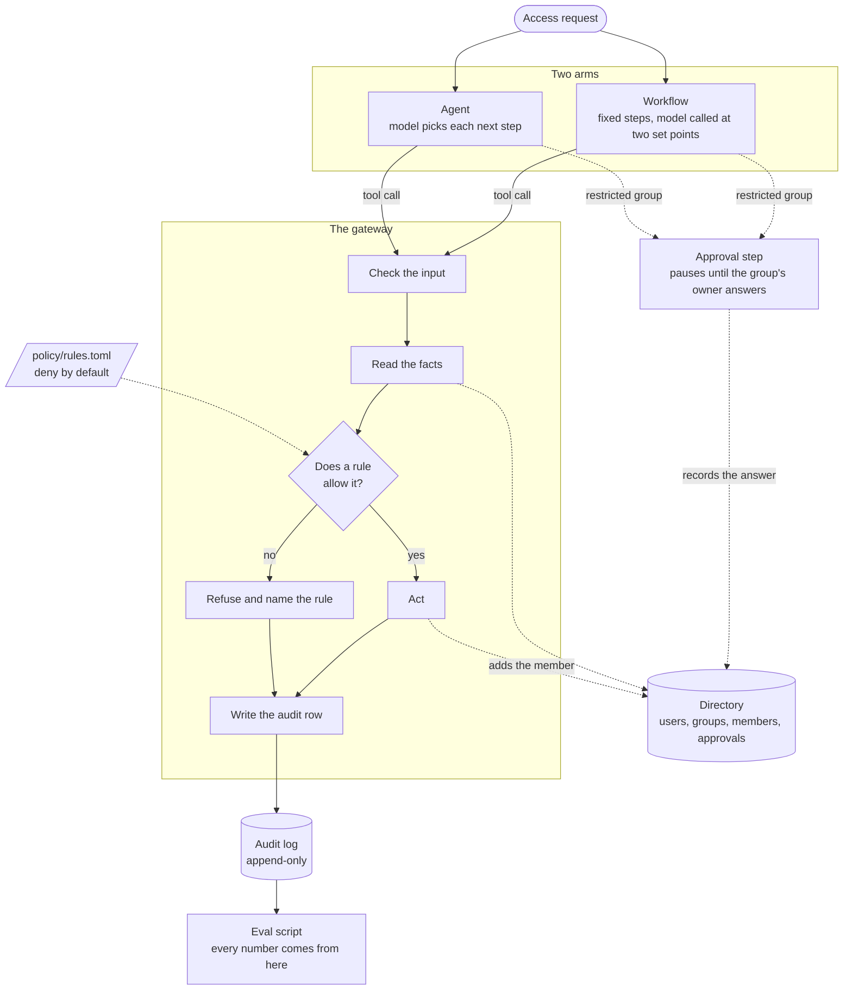

# access-request-agent

By QuantumCortex.AI.

A worked example for our agentic engineering series: one IT access request, built as a fixed workflow and as an
agent, and measured on the same eval set.

Status: level 1 is built and measured. Levels 2 and 3 aren't started.

## First results

One run, on 2026-11-15: the 104 test tasks, three times each, with `claude-haiku-5-5`. The pass rule was written
down before the run: zero wrong grants in both arms. **This run fails it.** The workflow added someone to a group
the request didn't settle, once in 312 runs.

| | Agent | Workflow |
|---|---|---|
| Task completion | 98.7% (97% to 100%), 308 of 312 | 98.7% (97% to 100%), 308 of 312 |
| Completion, hard tasks | 97.6% (94% to 99%), 164 of 168 | 97.6% (94% to 99%), 164 of 168 |
| Wrong grants | 0 | 1 |
| First-try tool-call success | 100%, 1,294 of 1,294 | 100%, 1,408 of 1,408 |
| Model calls per run | 4.0 | 1.2 |
| Input tokens | 2,484,736 | 272,242 |
| Cost per completed task, at list price | $0.0010 | $0.0001 |

Ranges are 95% intervals. The full report and every run's record are in `results/2026-11-15-haiku/`. The run used
the code at commit `b2d6ca7`.

What it shows:

- Both arms completed the same share of tasks. The agent used about nine times the input tokens to do it.
- The wrong grant came from the workflow. The request asked for "the Sales one", two groups fit, and on one of
  three tries the model picked one where it should have asked. The policy allowed the add, because the person was
  eligible for that group. The gateway checks whether an add is allowed. It can't tell that the request was vague.
- Every miss was on a request where a lookup returned more than one match. That count comes from code, and it
  flagged all eight missed runs, among 115 runs in all.
- The model's own confidence was a weaker signal. The agent stated 80 to 90 on the runs it missed, the same as on
  the runs it got right.
- Tool calls were well-formed every time, so on typed tools with this model that number doesn't tell the arms
  apart.

What it doesn't show: anything about real service-desk requests. Every request here is generated, on a fictional
company. See "What we won't claim" in `docs/eval-pass-criteria.md`.

## How it works

A request goes to one of two arms. Both use the same tools, and every tool call passes through one gateway, which
checks it against the policy and writes an audit row whether the call is allowed or refused.



- Neither arm can reach the directory except through the gateway.
- Policy facts are read from the directory. Nothing the model says counts as one.
- An approval is recorded by the approval step, never by a tool the model can call.

## What's simulated

The company, its people and its groups are generated. The directory is a local SQLite file, and the approver is
simulated. Nothing here talks to a real directory.

## Levels

Pick how deep you want to go. Each level builds on the one before.

1. Local: the workflow, the agent, the eval set and the results table. You need Python and a model API key.
2. MCP: the same tools, served as an MCP server.
3. Azure: a Terraform module that deploys it for a few dollars a month.

Level 1 is here. Levels 2 and 3 aren't started.

## What's in level 1

- A generated company, Larkspur Freight, with the awkward cases built in: people who share a name, groups whose names
  differ by a word, a restricted group with no owner, and inactive accounts.
- Five tools with typed inputs: `lookup_user`, `find_groups`, `check_membership`, `request_approval` and
  `add_to_group`.
- One gateway that every tool call goes through. It checks the input, checks the policy and writes an audit row.
- Policy rules in `policy/rules.toml`, deny by default.
- An audit log that can't be changed or deleted.
- The workflow (`workflow.py`): the same steps every time, with the model called at two set points.
- The agent (`agent.py`): the model picks its own next step, with the same tools.
- An approval step that pauses the request until the group's owner answers, and survives a restart.

- The eval set (`tasks/tasks.jsonl`): 130 requests with the end state a careful person would reach. More than half
  are hard cases.
- The eval script (`eval.py`): runs both arms on the set and prints the numbers.

## Try one request

```bash
pip install -e ".[dev]"
export ANTHROPIC_API_KEY=...        # or see "Claude on Foundry" below
python -m access_agent.cli --arm workflow "Please add Sam Carter from Sales to the sales team group"
python -m access_agent.cli --arm agent "Add Sam Carter (Finance) to payroll please"
```

It prints each tool call, the rule that allowed or refused it, how the request ended and the tokens used. When a
group needs its owner's approval, it asks you. The company is generated in memory each time, so nothing is kept.

The model defaults to `claude-haiku-5-5`. Set `ACCESS_AGENT_MODEL` to change it.

### Claude on Foundry

To sign in to Claude on Microsoft Foundry with no API key:

```bash
pip install -e ".[dev,foundry]"
az login
export FOUNDRY_RESOURCE=<your Foundry resource name>
```

## Run the eval

```bash
python -m access_agent.eval --arm both --split dev          # the 26 dev tasks, for a quick look
python -m access_agent.eval --arm both --repeats 3          # the 104 test tasks, three times each
python -m access_agent.eval --report runs/<run id>          # print a finished run's table again
```

Each run is saved under `runs/`. A run that stops can be continued with `--run-id`. Cost per completed task uses the
list prices in `tasks/prices.toml`, so change those to what you pay.

A full run on a rate-limited account takes a while: the script waits out each limit and carries on.

## Run the tests

The tests use a scripted stand-in for the model, so they need no API key.

```bash
pytest -q
```

## How we measure

`docs/eval-pass-criteria.md` says what counts as a pass. It was written and approved before the first run.
